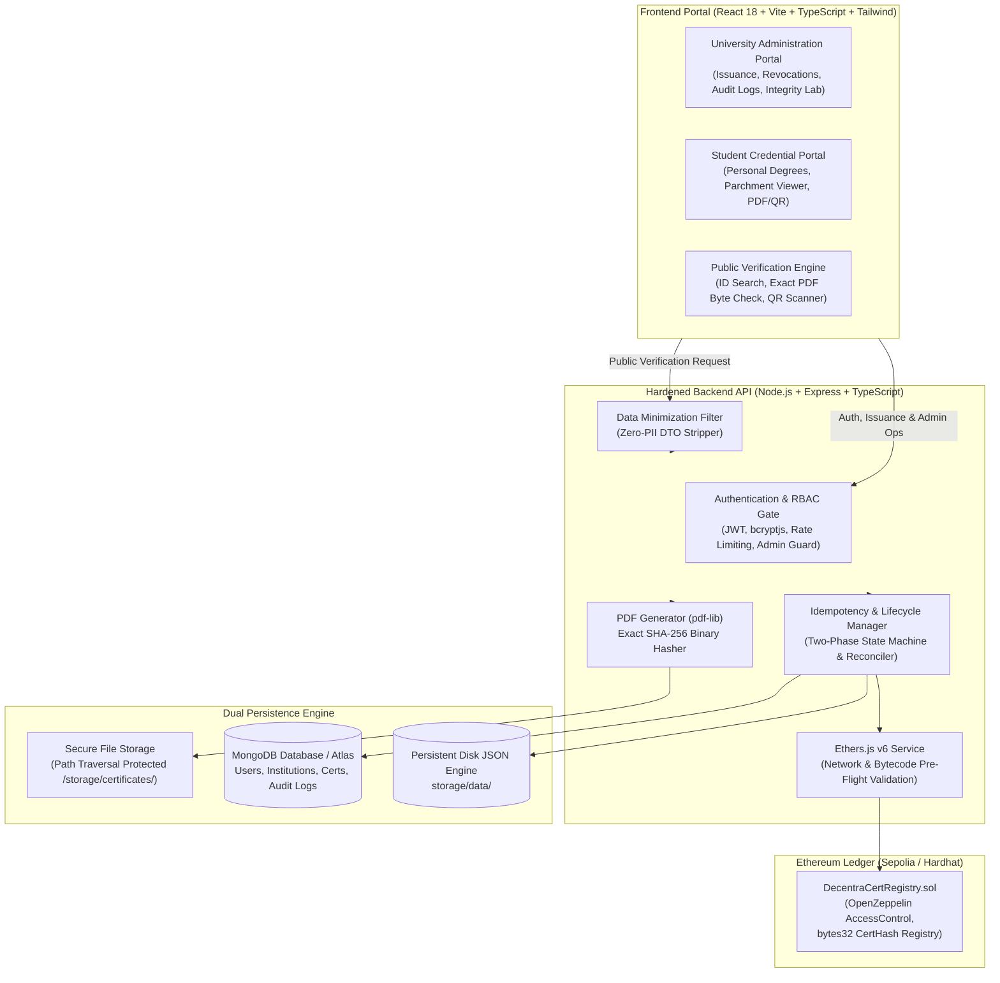

# DecentraCert 🎓🔗
### Enterprise Blockchain-Based Academic Credential Issuance & Verification Platform

[](https://opensource.org/licenses/MIT)
[](https://nodejs.org/)
[](https://www.typescriptlang.org/)
[](https://soliditylang.org/)
[](https://ethereum.org/)
[-success)](#-api-security-hardening--penetration-testing)
[](https://github.com/Alok04S/Decentracet)

> **"Trust Every Credential. Verify on Chain."**  
> DecentraCert eliminates academic diploma fraud, forged credentials, and unauthorized resume inflation. By binding **exact byte-level SHA-256 PDF hashes** to an immutable Ethereum smart contract, educational institutions can issue tamper-proof certificates that students, recruiters, and third-party verifiers can independently authenticate in milliseconds—without intermediaries or centralized points of failure.

---

## 📑 Table of Contents

1. [Key Features & Capabilities](#-key-features--capabilities)
2. [High-Level Architecture](#-high-level-architecture)
3. [Technology Stack](#-technology-stack)
4. [Pre-Loaded Enterprise Dataset (100 Students / 800 Credentials)](#-pre-loaded-enterprise-dataset)
5. [Core Engineering Implementations](#-core-engineering-implementations)
   - [1. Exact PDF Byte SHA-256 Hashing](#1-exact-pdf-byte-sha-256-hashing)
   - [2. Dual-Ledger Consistency & Reconciliation](#2-dual-ledger-consistency--reconciliation)
   - [3. Interactive Academic Integrity Lab](#3-interactive-academic-integrity-lab)
   - [4. Ornate Parchment Diploma Experience](#4-ornate-parchment-diploma-experience)
6. [API Security Hardening & Penetration Testing](#-api-security-hardening--penetration-testing)
7. [REST API Reference](#-rest-api-reference)
8. [Smart Contract Specification](#-smart-contract-specification)
9. [Project Directory Structure](#-project-directory-structure)
10. [Getting Started & Installation](#-getting-started--installation)
11. [Running Automated Tests](#-running-automated-tests)
12. [Troubleshooting & Firewall Guidance](#-troubleshooting--firewall-guidance)
13. [License & Acknowledgments](#-license--acknowledgments)

---

## 🌟 Key Features & Capabilities

- **Immutable On-Chain Verification**: Certificates are permanently anchored to Ethereum (Sepolia Testnet or local Hardhat node) via OpenZeppelin-secured smart contracts.
- **Byte-Level PDF Cryptographic Hashing**: Hashes raw generated binary PDF bytes directly (`Node.js crypto.createHash('sha256')`). Even a 1-bit alteration completely changes the digest, triggering immediate cryptographic rejection.
- **Enterprise-Grade Role-Based Access Control (RBAC)**:
  - 🏛️ **University Administrator**: Full administrative control, issuer management, credential revocation, background reconciliation, and institutional audit log inspection.
  - ✍️ **Academic Issuer / Registrar**: High-volume single and batch certificate issuance, student directory search, and analytics dashboard.
  - 🎓 **Student / Graduate**: Dedicated portal to inspect personal conferred degrees, view stylized parchment diplomas, download official PDFs, and access dynamic QR codes.
  - 🔍 **Public Verifier / Employer**: Zero-login verification portal supporting Instant ID lookup, QR scanning, and drag-and-drop raw PDF tamper checks.
- **Zero-PII Data Minimization**: Public verification endpoints omit student email addresses, full university enrollment IDs, internal database `_id`s, and server storage paths.
- **Fault-Tolerant Standalone Storage**: Built with a dual-persistence engine (MongoDB with automatic fallback to persistent file-backed JSON storage) guaranteeing zero downtime even if MongoDB is offline or blocked by local antivirus software.
- **Interactive Academic Integrity Testing Lab**: An embedded security laboratory allowing administrators to run original certificate checks, execute live 1-byte file mutations, observe the cryptographic avalanche effect in real time, and verify that forged documents fail on-chain validation.

---

## 🏛️ High-Level Architecture



---

## 🛠️ Technology Stack

| Layer | Technologies | Description |
|---|---|---|
| **Frontend** | React 18, Vite, TypeScript, Tailwind CSS | High-performance SPA with enterprise light theme |
| **Icons & UI** | Lucide React, Canvas Confetti, QR Code Generator | Responsive modals, printable parchment diplomas, and alerts |
| **Backend** | Node.js, Express.js, TypeScript | Modular REST API with strict input sanitization |
| **Blockchain** | Solidity 0.8.24, Hardhat, Ethers.js v6, OpenZeppelin | Gas-optimized `bytes32` credential registry |
| **Cryptography** | SHA-256, PDF-Lib, Bcrypt.js, Ethers Crypto | Byte-level document hashing and secure credential storage |
| **Security** | Helmet, CORS, Express-Rate-Limit, Zod | Defense-in-depth API hardening, RBAC, path traversal guards |
| **Persistence** | MongoDB (Mongoose) + Persistent JSON Storage | Dual-mode persistence with automatic antivirus fallback |

---

## 🎓 Pre-Loaded Enterprise Dataset

DecentraCert comes pre-loaded with an enterprise demonstration registry consisting of **100 verified students** and **800 digitally hashed academic credentials** (8 degrees/honors per student) across 10 academic faculties:

### 10 Academic Faculties Represented
1. Department of Computer Science & Software Systems
2. Department of Artificial Intelligence & Robotics
3. Department of Cybersecurity & Cryptographic Engineering
4. Department of Data Science & Big Data Analytics
5. Department of Electrical & Computer Engineering
6. Department of Biotechnology & Genomic Sciences
7. Department of Business Informatics & Quantitative Finance
8. Department of Mechanical & Autonomous Systems
9. Department of Quantum Computing & Applied Physics
10. Department of Information Systems & Cloud Architectures

### 8 Conferred Credentials Per Graduate
Each student holds 8 verifiable certificates:
- **Credential 1**: Primary Degree Diploma (B.S. / M.S. Summa Cum Laude / High Distinction)
- **Credential 2**: Dean's Honor Roll & Academic Excellence Award
- **Credential 3**: Departmental Specialization & Minor Concentration
- **Credential 4**: Senior Capstone Thesis Defense Certification
- **Credential 5**: Advanced Industrial Practicum & Research Residency
- **Credential 6**: Professional Technical Certification (CCSE / Master Level)
- **Credential 7**: University Presidential Innovation Fellowship
- **Credential 8**: Institutional Academic Integrity & Research Ethics Verification

*Note: 40 credentials (~5%) are realistically flagged as `revoked` with official Academic Senate disciplinary reasons for testing revocation validation workflows.*

### Default Accounts for Immediate Testing

| Role | Email Address | Password | Permissions & Scope |
|---|---|---|---|
| **University Administrator** | `admin@decentracert.edu` | `Admin@123` | Full administrative control, revocation, audit logs |
| **Academic Issuer** | `issuer@decentracert.edu` | `Issuer@123` | Credential issuance, batch processing, dashboard stats |
| **Student (Candidate 1)** | `student001@decentracert.edu` | `Student@123` | View own 8 degrees, view parchment, download PDFs/QRs |
| **Student (Candidate 2)** | `student002@decentracert.edu` | `Student@123` | View own 8 degrees, horizontally isolated from Student 1 |
| *Students 003 – 100* | `student003@decentracert.edu` ... | `Student@123` | Individual accounts for all 100 students |

---

## 🔬 Core Engineering Implementations

### 1. Exact PDF Byte SHA-256 Hashing
Unlike basic platforms that hash arbitrary JSON metadata strings, DecentraCert hashes the **exact raw binary bytes of the rendered PDF document**:

```
[Student Record + Institutional Keys]
                 ↓
      pdf-lib (A4 Diploma Render)
                 ↓
        Buffer (Binary PDF Bytes)
                 ↓
crypto.createHash('sha256').update(buffer).digest('hex')
                 ↓
       0x... (Solidity bytes32)
                 ↓
Ethereum Smart Contract Registry: verifyCertificate(bytes32)
```

- **Cryptographic Avalanche Effect**: Changing even a single letter in the student's name, degree title, or issue date completely alters the SHA-256 hash digest.
- **Node.js ↔ Solidity Compatibility**: The 64-character lowercase hex digest is converted to `0x`-prefixed 32-byte representation (`bytes32`), ensuring byte-for-byte fidelity across Web3 libraries and smart contracts.

### 2. Dual-Ledger Consistency & Reconciliation
To resolve potential network or persistence disconnects between Ethereum and the local database:
- **Two-Phase Lifecycle Machine**: Credentials progress through strict states: `draft` → `submitting` → `confirmed` / `failed`.
- **Idempotency**: Every issuance request accepts an `idempotencyKey` preventing duplicate transaction execution.
- **Autonomous Background Reconciler**: Runs on a background interval scanning any interrupted or pending transactions. If a transaction mined on-chain during a database disconnect, the reconciler automatically verifies the contract receipt and reconciles the state.

### 3. Interactive Academic Integrity Lab
Accessible under **Integrity Lab** in the Administration Dashboard:
1. Select any issued credential from the registry.
2. Run baseline verification on the original untampered PDF (confirms 100% on-chain match).
3. Execute a simulated **1-Byte Tamper Mutation** (flips a single bit in the binary stream).
4. Observe the hash difference display side-by-side with diff indicators.
5. Watch the on-chain engine reject the tampered document with a detailed cryptographic failure report.

### 4. Ornate Parchment Diploma Experience
DecentraCert provides a high-fidelity academic diploma viewer ([CertificateParchmentModal.tsx](file:///d:/BlockChain%20Projects/Decentracet/frontend/src/components/common/CertificateParchmentModal.tsx)):
- Classical textured cream parchment styling with ornate double navy and gold inset borders.
- Embossed university crest seal watermark.
- Dual academic signatures (Dean of Academic Affairs & University President).
- Embedded dynamic QR code for instant smartphone camera verification.
- One-click actions: **Download Official PDF**, **Print Diploma**, and **Verify On Chain**.

---

## 🛡️ API Security Hardening & Penetration Testing

All endpoints have been hardened and verified with an automated 43-point penetration test suite ([verify-api-security.ts](file:///d:/BlockChain%20Projects/Decentracet/backend/scripts/verify-api-security.ts)):

```
================================================================================
             DECENTRACERT API SECURITY AUDIT & PENETRATION SUITE                
 Target Server: http://localhost:5000
================================================================================
Total Security Checks Executed : 43
Checks Passed                  : 43
Checks Failed                  : 0
Security Compliance Score      : 100.0%
================================================================================
🎉 ALL ENDPOINTS PROPERLY HARDENED, CLOSED, AND ZERO LEAKS DETECTED!
```

### Defense Measures Implemented:
1. **Unauthenticated Access Protection**: 13 sensitive administrative and institutional routes strictly reject unauthenticated requests with `401 Unauthorized`.
2. **Public Self-Registration Role Escalation**: Public registration at `POST /api/auth/register` permits only `student` roles; attempts to assign `admin`, `issuer`, or `verifier` return `403 Forbidden`. Dedicated rate limiting protects `/login` and `/register`.
3. **Horizontal Privilege Isolation**: Students can strictly view, download, and query only their own credentials. Querying or downloading another student's PDF or QR code returns `403 Forbidden`.
4. **Vertical Privilege Isolation**: Non-privileged students attempting to access institutional dashboard metrics, issue credentials, revoke certificates, or view audit logs are blocked with `403 Forbidden`.
5. **Issuer Privilege Boundary**: Academic Issuers can access dashboard statistics and issue certificates, but are blocked (`403 Forbidden`) from revoking certificates or inspecting institutional audit logs.
6. **Zero-PII Public Verification**: Public endpoints (`/api/verify/id` and `/api/verify/hash`) scrub student emails, enrollment IDs, MongoDB `_id`s, and storage file paths.
7. **Path Traversal Defense**: All file retrieval operations sanitize inputs with `path.basename` and enforce `resolvedPath.startsWith(this.baseDir)`. Traversal vectors (`../../package.json`, etc.) are cleanly rejected.
8. **Information Leakage & Fingerprinting**: Global error handlers catch syntax errors and unhandled exceptions without leaking stack traces or internal drive paths (`D:\...`). `X-Powered-By` headers are stripped.

---

## 📡 REST API Reference

### Authentication (`/api/auth`)
| Method | Endpoint | Role | Description |
|---|---|---|---|
| `POST` | `/api/auth/register` | Public (Rate-limited) | Register student account (admin/issuer roles blocked) |
| `POST` | `/api/auth/login` | Public (Rate-limited) | Authenticate user & return signed JWT |
| `GET` | `/api/auth/me` | Authenticated | Retrieve current session profile |

### Certificates (`/api/certificates`)
| Method | Endpoint | Role | Description |
|---|---|---|---|
| `GET` | `/api/certificates` | Authenticated | List certificates (students filtered to own records) |
| `GET` | `/api/certificates/:id` | Authenticated | Get credential details (ownership verified for students) |
| `GET` | `/api/certificates/:id/pdf` | Authenticated | Stream official PDF (ownership verified) |
| `GET` | `/api/certificates/:id/qr` | Authenticated | Stream dynamic QR code (ownership verified) |
| `POST` | `/api/certificates` | Admin, Issuer | Issue new certificate, compute SHA-256 & register on chain |
| `POST` | `/api/certificates/:id/revoke` | Admin Only | Revoke credential on blockchain with mandatory reason |
| `POST` | `/api/certificates/:id/reconcile`| Admin Only | Force on-chain reconciliation check for certificate |

### Public Verification (`/api/verify`)
| Method | Endpoint | Role | Description |
|---|---|---|---|
| `POST` | `/api/verify/id` | Public | Verify certificate by ID (Zero-PII sanitized) |
| `POST` | `/api/verify/hash` | Public | Verify certificate by exact SHA-256 hash |
| `POST` | `/api/verify/pdf` | Public | Upload PDF & verify exact binary byte integrity |
| `GET` | `/api/verify/:id/pdf` | Public | Download verified public diploma PDF |
| `GET` | `/api/verify/:id/qr` | Public | Get public verification QR code stream |

### Dashboard & Analytics (`/api/dashboard`)
| Method | Endpoint | Role | Description |
|---|---|---|---|
| `GET` | `/api/dashboard/stats` | Admin, Issuer | Institutional issuance KPIs, active/revoked counts |
| `GET` | `/api/dashboard/recent-certificates` | Admin, Issuer | Stream latest issued credentials |
| `GET` | `/api/dashboard/recent-verifications` | Admin, Issuer | Stream verification requests and success rates |

### Ledger & Auditing
| Method | Endpoint | Role | Description |
|---|---|---|---|
| `GET` | `/api/blockchain/status` | Public | RPC connection status & deployed contract verification |
| `GET` | `/api/blockchain/transactions`| Admin, Issuer | Query on-chain transaction history |
| `GET` | `/api/audit-logs` | Admin Only | Query immutable system audit trail |
| `POST` | `/api/integrity-test/execute` | Admin, Issuer | Execute live laboratory 1-byte mutation test |

---

## ⛓️ Smart Contract Specification

The smart contract [`DecentraCertRegistry.sol`](file:///d:/BlockChain%20Projects/Decentracet/blockchain/contracts/DecentraCertRegistry.sol) is written in Solidity 0.8.24 using OpenZeppelin's `AccessControl`:

### Roles
- `DEFAULT_ADMIN_ROLE`: Contract deployer / Dean of Registrar. Can grant/revoke roles and revoke certificates.
- `ISSUER_ROLE`: Authorized academic institutions. Can issue and register certificate hashes.

### Key Functions
- `issueCertificate(bytes32 _certHash, string _certificateId, string _studentName, string _degree, string _institution)`: Anchors a certificate to the blockchain. Emits `CertificateIssued`.
- `verifyCertificate(bytes32 _certHash)`: View function returning `(bool exists, bool isValid, bool isRevoked, address issuer, uint256 issuedAt)`.
- `revokeCertificate(bytes32 _certHash, string _reason)`: Marks an existing certificate as revoked. Emits `CertificateRevoked`.
- `getCertificateDetails(bytes32 _certHash)`: Retrieves full stored metadata and revocation timestamps.

---

## 📂 Project Directory Structure

```text
Decentracet/
├── blockchain/                         # Hardhat smart contract environment
│   ├── contracts/
│   │   └── DecentraCertRegistry.sol    # OpenZeppelin credential registry
│   ├── scripts/
│   │   └── deploy.js                   # Deployment script with auto-config export
│   ├── test/
│   │   └── DecentraCertRegistry.test.js# 14 passing contract unit tests
│   └── hardhat.config.js               # Network settings (Hardhat & Sepolia)
│
├── backend/                            # Express + TypeScript REST API
│   ├── src/
│   │   ├── config/                     # Blockchain client, database, env
│   │   ├── controllers/                # Auth, Certificate, Verify, Dashboard, Lab
│   │   ├── middleware/                 # JWT Auth, RBAC, Rate Limiters, Upload
│   │   ├── models/                     # Mongoose schemas (User, Cert, Logs)
│   │   ├── routes/                     # Hardened Express router definitions
│   │   ├── services/                   # Hash, PDF, QR, Storage, Reconciliation
│   │   ├── scripts/                    # Database generators (100 students / 800 certs)
│   │   ├── app.ts                      # App configuration, Helmet, Error handler
│   │   └── index.ts                    # Bootstrapper & background reconciler
│   ├── storage/data/                   # Standalone persistent JSON storage
│   ├── scripts/
│   │   └── verify-api-security.ts      # Automated 43-point penetration test suite
│   └── tsconfig.json
│
├── frontend/                           # React 18 + Vite + Tailwind CSS SPA
│   ├── src/
│   │   ├── components/                 # Modals, Parchment viewer, Badges, Navbars
│   │   ├── pages/
│   │   │   ├── admin/                  # Dashboard, Issuance, Students, Integrity Lab
│   │   │   ├── student/                # Student degrees portal & parchment
│   │   │   ├── verify/                 # Public instant verifier & tamper checks
│   │   │   └── public/                 # Enterprise landing page
│   │   ├── context/                    # AuthContext (JWT session state)
│   │   └── services/                   # API client bindings
│   └── vite.config.ts
│
├── package.json                        # Root workspace orchestration
├── README.md                           # Master documentation
└── .gitignore
```

---

## 🚀 Getting Started & Installation

### Prerequisites
- [Node.js](https://nodejs.org/) (v18.0.0 or higher)
- [npm](https://www.npmjs.com/) (v9.0.0 or higher)
- *Optional*: [MongoDB](https://www.mongodb.com/) (Local or Atlas URI). If not available, DecentraCert automatically runs on its built-in persistent disk JSON storage.

### 1. Clone & Install Dependencies

```bash
# Clone the repository
git clone https://github.com/Alok04S/Decentracet.git
cd Decentracet

# Install root, blockchain, backend, and frontend dependencies
npm install
npm install --prefix blockchain
npm install --prefix backend
npm install --prefix frontend
```

### 2. Configure Environment Variables

#### Backend Configuration (`backend/.env`):
```env
PORT=5000
NODE_ENV=development
FRONTEND_URL=http://localhost:5173

# Database (Leave as is for persistent local storage or point to MongoDB Atlas)
MONGODB_URI=mongodb://localhost:27017/decentracert

# Security
JWT_SECRET=decentracert_super_secure_jwt_secret_key_change_in_production
JWT_EXPIRES_IN=7d

# Blockchain (Local Hardhat Node or Ethereum Sepolia)
CHAIN_ID=31337
RPC_URL=http://127.0.0.1:8545
CONTRACT_ADDRESS=0x5FbDB2315678afecb367f032d93F642f64180aa3
PRIVATE_KEY=0xac0974bec39a17e36ba4a6b4d238ff944bacb478cbed5efcae784d7bf4f2ff80
```

#### Blockchain Configuration (`blockchain/.env`) *(Optional for Sepolia)*:
```env
SEPOLIA_RPC_URL=https://eth-sepolia.g.alchemy.com/v2/YOUR_ALCHEMY_KEY
PRIVATE_KEY=YOUR_SEPOLIA_PRIVATE_KEY_WITHOUT_0X
ETHERSCAN_API_KEY=YOUR_ETHERSCAN_API_KEY
```

---

## 🏃 Running the Application

### Step 1: Start Local Hardhat Blockchain
```bash
cd blockchain
npx hardhat node
```
*Leave this running in Terminal 1.*

### Step 2: Deploy Smart Contract
In a new terminal:
```bash
cd blockchain
node scripts/deploy.js
```
*(The deploy script automatically updates contract addresses and ABIs for both backend and frontend).*

### Step 3: Seed 100 Students & 800 Credentials
```bash
cd backend
npm run seed:demo
```

### Step 4: Start Backend API Server
```bash
cd backend
npm run dev
```
*Backend runs at `http://localhost:5000`. Health check: `http://localhost:5000/api/health`.*

### Step 5: Start Frontend Client
```bash
cd frontend
npm run dev
```
*Open `http://localhost:5173` in your browser.*

---

## 🧪 Running Automated Tests

### 1. Smart Contract Test Suite (14 Tests)
```bash
cd blockchain
npx hardhat test
```
*Verifies AccessControl roles, authorized issuance, duplicate prevention, invalid hash rejection, revocation states, and event logs.*

### 2. Backend Integration Test Suite (17 Tests)
```bash
cd backend
npm test
```
*Verifies exact byte hashing, idempotency, horizontal isolation, and ledger reconciliation.*

### 3. Comprehensive Security Penetration Test Suite (43 Checks)
```bash
cd backend
npx tsx scripts/verify-api-security.ts
```
*Executes full 43-point penetration test: unauthenticated boundaries, role escalation, horizontal student isolation, zero-PII validation, path traversal, and stack trace suppression.*

---

## 🛡️ Troubleshooting & Firewall Guidance

If Windows Firewall or your antivirus software shows an alert regarding local MongoDB or network ports:

1. **Option 1: Built-in Standalone Engine (Zero Setup / Zero Firewall)**:
   - DecentraCert includes a built-in persistent disk JSON storage engine in `backend/storage/data/`.
   - The application automatically switches to this engine if MongoDB is blocked by local firewalls or antivirus software, requiring zero configuration.
2. **Option 2: Free MongoDB Atlas (Zero Local Port Binding)**:
   - Create a free cloud cluster at [MongoDB Atlas](https://www.mongodb.com/cloud/atlas).
   - In `backend/.env`, set `MONGODB_URI=mongodb+srv://<user>:<password>@cluster.mongodb.net/decentracert`.
   - Because Atlas uses outbound TLS connections on standard port 443, local firewalls never trigger inbound block alerts.
3. **Option 3: Official MongoDB Windows Service**:
   - Install the officially signed installer from [mongodb.com](https://www.mongodb.com/try/download/community) and run `net start MongoDB`.

---

## 📄 License & Acknowledgments

This project is licensed under the **MIT License** — see the [LICENSE](LICENSE) file for details.

Developed for university credential assurance, blockchain verification research, and zero-trust academic certification.
